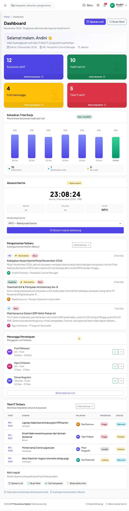

# Nusantara Portal — Company Portal



Aplikasi **portal perusahaan internal** yang dibangun dengan **React + Vite + TypeScript** dan antarmuka **AdminLTE 4** (Bootstrap 5.3). Seluruh data bersifat demo dan disimpan di `localStorage` browser, sehingga setiap mutasi bertahan antar sesi tanpa backend.

## Fitur

- **Login** dengan peran **Administrator** dan **Karyawan**, plus akun demo cepat.
- **Dashboard** ringkasan KPI, grafik kehadiran 7 hari, pengumuman penting, antrian persetujuan, dan tiket terbaru.
- **Pengumuman** dengan pin, kategori, pencarian, dan CRUD (admin).
- **Direktori Karyawan** dengan pencarian, filter departemen, dan profil detail.
- **Dokumen** dengan kategori, pencarian, unduhan (simulasi), dan manajemen (admin).
- **Cuti & Absensi** — pengajuan cuti, validasi tanggal, persetujuan/penolakan, clock in/out, riwayat.
- **Tiket IT** — pembuatan, prioritas, status, komentar, dan penugasan (admin).
- **Manajemen Karyawan** (admin) — tambah, edit, aktif/nonaktif.
- **Profil Saya** — ubah data diri, kata sandi, dan reset data demo.
- **Tema gelap/terang**, pencarian global, notifikasi, aksi cepat, dan tampilan responsif (mobile drawer).

## Menjalankan proyek

```bash
npm install
npm run dev      # http://localhost:5173
npm run build    # typecheck + build produksi
npm run typecheck
npm run preview
```

## Akun demo

| Peran | Email | Kata sandi |
| --- | --- | --- |
| Administrator | `admin@nusantara.co.id` | `admin123` |
| Karyawan | `budi@nusantara.co.id` | `karyawan123` |

## Data & penyimpanan

- State aplikasi disimpan di `localStorage` dengan kunci:
  - `nusantara-portal-db-v1` (basis data demo)
  - `nusantara-portal-session-v1` (sesi login)
  - `nusantara-theme` (tema)
  - `nusantara-remember-email` (email yang diingat)
- Data seed memakai tanggal relatif agar selalu relevan.
- **Reset data demo** tersedia di halaman **Profil Saya** → mengembalikan data awal tanpa menghapus sesi.

## Struktur utama

```
src/
  App.tsx            # routing & guard peran
  main.tsx           # entry + import CSS AdminLTE
  index.css          # kustomisasi AdminLTE
  data/seed.ts       # data awal PT Nusantara Digital
  store/AppStore.tsx # state global + aksi CRUD
  components/        # Layout, UI bersama
  pages/             # Login, Dashboard, Pengumuman, Direktori, Dokumen, Cuti, Tiket, Admin, Profil
  lib/               # utilitas & label
  types.ts
```

## Catatan

- AdminLTE JavaScript sengaja tidak diimpor; sidebar mobile dikontrol manual via kelas `body.sidebar-open`.
- Hosting statis memerlukan SPA fallback ke `index.html`.
- Semua fitur berjalan sepenuhnya di sisi klien (tanpa backend).